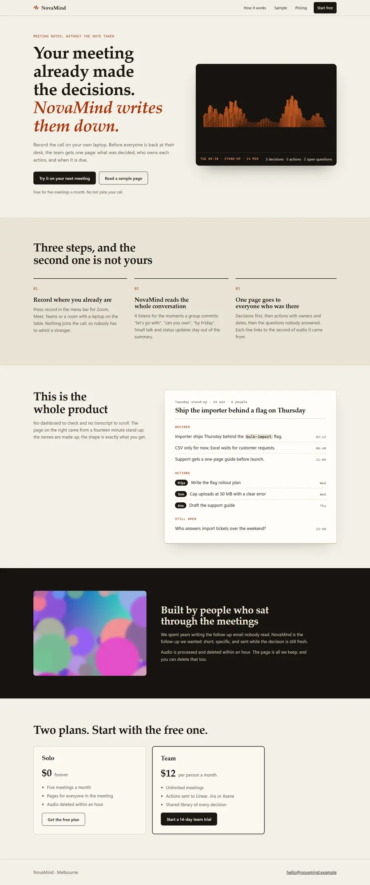

# Site Audit

Find what's broken on a website before your visitors do.

Site Audit opens every page at six screen sizes, from a 360 px phone to a 2560 px monitor, in a real browser. It presses every button and every `#` link once and names the ones that do nothing. It finds text cut off by its box or sitting on other text, and images that look blurry on a phone's high-density screen. It also measures what the page costs: weight, unused code, CPU while nobody touches it, and for 3D, draw calls, graphics memory and drawing while idle or scrolled away.

It prints a FAIL or WARN line for each problem and saves a JSON report and full-page screenshots at every width.

| Before | After |
|---|---|
|  |  |

## The test

`demo/bad` is the kind of landing page an AI site builder turns out in a minute, with the faults planted on purpose. `demo/fixed` is the same product rebuilt properly. (NovaMind is made up.)

| | Bad page | Rebuilt |
|---|---:|---:|
| Failures | 82 | 0 |
| Warnings | 63 | 1 |
| First load | 40,323 KB | 175 KB |
| Blocking time, phone with the CPU slowed 4x | 1,318 ms | 0 ms |
| WebGL draw calls a second while idle | 86,100 | 0 |
| Texture memory | 85 MB | 0 MB |

Counts are per width, so a fault seen at all six widths counts six times. The one warning left is three.js loaded whole from a CDN; the page uses about 40% of it.

It was also run on [chronox.com.au](https://www.chronox.com.au/site-audit), a site with a 3D hi-fi panel, where it found the panel drawing 46,471 draw calls a second with nothing moving. That page has the before and after.

Rerun the test yourself:

```bash
npm install
npm run demo:images        # makes the bad page's 40 MB of images (Python 3 and Pillow)
npm run demo:bad           # http://127.0.0.1:4610, leave it running
npm run demo:fixed         # http://127.0.0.1:4611, in a second terminal
node audit.cjs http://127.0.0.1:4610 demo/before
node audit.cjs http://127.0.0.1:4611 demo/after
```

## Use it

Needs Node 18 or later and Edge or Chrome installed. With neither, run `npx playwright install chromium`.

```bash
git clone https://github.com/Chronox2290/site-audit
cd site-audit
npm install
node audit.cjs https://example.com out --paths /,/about,/pricing
```

| Option | What it does |
|---|---|
| `--paths /,/about` | Pages to check (default `/`) |
| `--no-click` | Skip pressing every button |
| `--no-efficiency` | Skip the weight, CPU, 3D and video passes (about 40 s a page) |
| `--ignore file` | Known exceptions, default `.site-audit-ignore.json` in the current folder |
| `--browser msedge` | Pick the browser: `msedge`, `chrome` or `chromium` |

It exits with code 1 when anything fails, so it works as a check in CI or before a deploy.

An exception needs a reason saying how it is checked instead:

```json
[{ "selector": ".marquee", "reason": "scrolls on purpose; covered by tests/marquee.spec.js" }]
```

## With an AI coding agent

The script is plain Node, so any agent that can run a shell command can use it: Claude Code, Codex, Gemini CLI, Cursor or anything else.

For Claude Code, install it as a skill and it runs whenever the site changes:

```bash
git clone https://github.com/Chronox2290/site-audit ~/.claude/skills/site-audit
cd ~/.claude/skills/site-audit && npm install
```

`SKILL.md` tells the agent how to run it, what every threshold means and what it still has to look at with its own eyes. Other agents can be pointed at the same file.

## What it checks

Every threshold is listed in [SKILL.md](SKILL.md).

- **How it looks:** blurry and oversized images (against the screen's real pixel density), canvases drawn below that density, text cut off or overlapping, sideways scroll.
- **Whether it works:** page errors, failed requests, broken links, layout shift, and every button and `#` link pressed once.
- **Who can use it:** axe accessibility rules (serious and critical), tap targets under 24 px, text under 11 px, alt text, heading order, pinch zoom.
- **How heavy it is:** page weight, files sent uncompressed, old image formats, unused JS and CSS, render-blocking files, blocking time on a slowed phone, CPU while idle.
- **What the 3D costs:** draw calls and triangles per frame, texture sizes and memory, drawing while idle, drawing while scrolled away, canvases drawn above 2x on a phone. Works with any WebGL library.
- **Whether video survives the trip:** each video's bit depth, colour range and bitrate (with ffprobe installed), and whether the picture on screen matches the frame the browser decoded. A WebGL texture or filter that washes dark scenes out into blocks shows up here.
- **Search and sharing:** title and description length, canonical link, share image, favicon, robots.txt and sitemap.

## What it can't judge

Taste, whether the words are true, whether a 3D scene is framed well, sound, real phone GPU speed and anything behind a login. It never submits forms. Look at the screenshots.

## Licence

MIT. Made by Christian Murphy at [Chrono X](https://www.chronox.com.au), Melbourne. If you'd like it run on your site with the fixes done, [get in touch](https://www.chronox.com.au/#contact).
